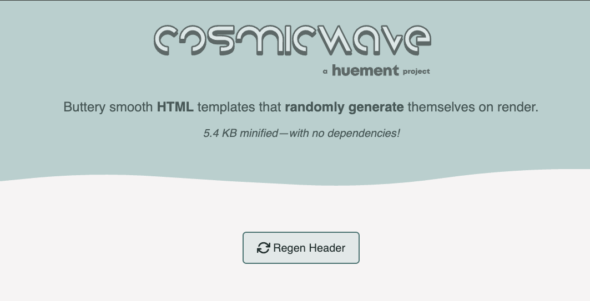

# 🌊 CosmicWave & CosmicPoly



Lightweight, dependency-free **HTML Web Components** that dynamically compute, render, and morph generative SVG paths natively on the open web. Create fluid, endless wave motions or toggle into a sharp, cyberpunk polygon aesthetic instantly.

---
## ✨ Features

- **Zero Dependencies:** Pure vanilla JS web components. Tiny footprint (~5.4 KB minified).
- **Subpath Tree-Shaking:** Import only what you use—smooth waves, sharp polygons, or both.
- **Hardware Accelerated:** Leverages `requestAnimationFrame` for super smooth 60fps path morphs.
- **Responsive Context Rules:** Paths naturally scale to their bounding parent containers.
- **Accessibility Mindful:** Automatically respects system `prefers-reduced-motion` flags.

## 🎮 Live Demos

Explore real-time visualizers and interactive code generators:
- [Classic CosmicWave Panel](https://huement.github.io/CosmicWave/)
- [Cyberpunk CosmicPolygon Matrix](https://huement.github.io/CosmicWave/polygon.html)

---
## 🚀 Installation

```bash
npm install @huement/cosmicwave
```

## 🛠️ Usage

### 1. Registering the Components
**Via Bundlers (Vite, Webpack, Rollup, Next.js)**
Import the precise custom elements you need into your app's main JavaScript/TypeScript entry point:

```javascript
// Register the Classic Smooth Wave element (<cosmic-wave>)
import '@huement/cosmicwave';

// Register the Cyberpunk Polygon element (<cosmic-poly>)
import '@huement/cosmicwave/poly';
```

**Via Direct HTML CDN (Zero-Compilation Setups)**
Drop the specific minified distribution modules straight into your HTML document <head>:

```html
<script src="[https://cdn.jsdelivr.net/gh/huement/CosmicWave@main/dist/cosmicwave.min.js](https://cdn.jsdelivr.net/gh/huement/CosmicWave@main/dist/cosmicwave.min.js)" crossorigin="anonymous"></script>

<script src="[https://cdn.jsdelivr.net/gh/huement/CosmicWave@main/dist/cosmicpoly.min.js](https://cdn.jsdelivr.net/gh/huement/CosmicWave@main/dist/cosmicpoly.min.js)" crossorigin="anonymous"></script>
```

### 2. HTML Markup Implementation
Once registered, implement the custom markup tags anywhere in your layout. Style them natively using standard CSS or utility framework classes like Tailwind:
HTML

```html
<cosmic-wave data-start-zero="true" class="fill-indigo-500/10 stroke-indigo-500"></cosmic-wave>

<cosmic-poly
  data-wave-face="bottom"
  data-wave-points="12"
  data-variance="4"
  data-wave-speed="4000"
  data-wave-animate="true"
  class="fill-fuchsia-500/20 stroke-fuchsia-500">
</cosmic-poly>
```

## 📑 Complete HTML Attributes API
Configure design and movement logic directly inside your markup using these custom dataset values:

| **Attribute String** | **Type** | **Default Value** | **Operational Details** |
|---|---|---|---|
| data-wave-face | String | "top" | Bounding direction face. Accepts "top", "bottom", "left", or "right". |
| data-wave-points | Number | 6 | Total numeric multi-point interpolation nodes across layout vectors. |
| data-variance | Number | 3 | Multiplier factor controlling peak randomization heights and depth displacement. |
| data-wave-speed | Number | 7500 | Full transition execution duration context in milliseconds per loop segment. |
| data-start-end-zero | Boolean | false | If "true", forces both origin and termination anchors to flatline at zero limits. |
| data-start-zero | Boolean | false | If "true", forces only the structural starting anchor point vector to flatline. |
| data-end-zero | Boolean | false | If "true", forces only the final closing structural anchor point vector to flatline. |
| data-wave-observe | String | unset | Binds an IntersectionObserver. Format pattern mode:rootMargin (e.g., "once:0px" or "repeat:50px"). Wakes up/pauses element based on viewport presence. |
| data-wave-animate | Boolean | false | If "true", initializes infinite animated loop morphing sequence timelines on load. |

## 🧠 Programmatic JavaScript Instance Methods
Access custom elements directly through standard DOM references to control individual animation engines programmatically:

```javascript
const matrixWave = document.querySelector('cosmic-poly');

// 1. Force calculation and execution of a single path morph transition
matrixWave.generateNewWave(800); // Pass transition speed override in ms

// 2. Start continuous rendering loop pipelines
matrixWave.play();

// 3. Halt calculations immediately, freezing paths safely at current coordinates
matrixWave.pause();
```

## ⚙️ Advanced Layout Flattening Controls
You can cleanly constrain the wave's randomness to accommodate overlapping layouts. For example, setting data-start-zero="true" and data-end-zero="true" simultaneously ensures the vectors anchor flatly on the outer margins while only morphing in the center—perfect for clean page-section dividers.

## License & Sponsorship

Distributed freely under the open-source **MIT License**. Maintained, optimized, and engineered / sponsored by **[HUEMENT](https://huement.com/)**.

<p align="center">
  <strong>If this software saved you time or a headache, consider keeping the engine running!</strong><br><br>
  <a href='https://ko-fi.com/U1A7222617' target='_blank'>
    
  </a>
</p>
